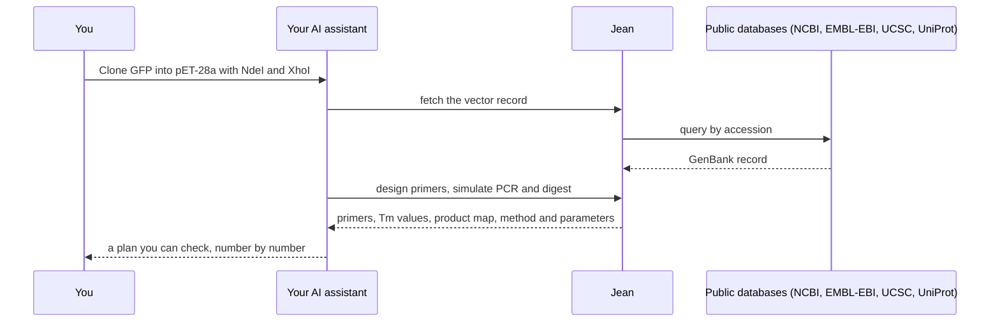

<div align="center">


# Jean by Melad Labs

### The bioinformatics & biotech suite, callable by any AI assistant

**<!-- COUNT:START -->287<!-- COUNT:END --> scientific tools · one URL · no key · free**

**Design** the construct · **Simulate** the bench step · **Analyze** what comes back · **Verify** the result

[](https://registry.modelcontextprotocol.io/v0.1/servers?search=io.github.genmnz/jean)


[](https://jeanslabs.vercel.app/docs/api/mcp)

[Connect](#-connect-in-thirty-seconds) · [How it works](#-how-it-works) · [What to ask](#-what-you-can-ask) · [Every tool](#-every-tool) · [FAQ](#-faq)

</div>

---

> **Your assistant is brilliant at reasoning and unreliable at science it has to compute.**
> Ask it for a melting temperature, a Gibson overlap, a ΔΔCq, a phylogeny or a peptide mass, and it
> answers from memory: fluently, confidently, and sometimes wrong. A wrong primer costs a week.
> A wrong conclusion costs a paper.

**Jean is a bioinformatics and biotech suite (scientific computing for the life sciences), and this is its door for AI.**
One engine, validated against the reference implementations of each field, served over the
[Model Context Protocol](https://modelcontextprotocol.io). Connect it once, and Claude, ChatGPT, Cursor,
VS Code or any MCP client can *compute* the answer instead of guessing it, across the whole arc of an
experiment:

| | |
|---|---|
| 🧬 **Design** | Constructs and assemblies, every primer and oligo, CRISPR guides, codon-optimized genes, RBS sites and operons, in-situ probes, barcodes, genetic circuits, variant libraries |
| 🧪 **Simulate** | Digests and gels, PCR products, multiplex screens, Gibson, Golden Gate and Gateway reactions, run on paper before they are run at the bench |
| 📊 **Analyze** | Sanger traces and NGS reads, qPCR and ddPCR runs, variants and copy number, expression and enrichment, phylogenies, mass-spec proteomics, antibodies, structures and small molecules |
| ✅ **Verify** | Prove the clone you got is the construct you drew, screen for vector contamination, recover how a construct was made |

<table>
<tr>
<td width="33%" valign="top">

#### 🎯 Calculated, not recalled
Thermodynamics, enzyme specificity, alignment scores and statistics are computed on every call, by
engines checked against the reference tools the field already relies on.

</td>
<td width="33%" valign="top">

#### 🔍 Explained, not asserted
Each answer carries its derivation: the method, the parameters, the inputs, and what would undermine
it. A reviewer can reproduce every number.

</td>
<td width="33%" valign="top">

#### 🔒 Private, not stored
The server is stateless: nothing you send is kept or carried between calls. No account, no key, no
tracking.

</td>
</tr>
</table>

## ⚡ Connect in thirty seconds

| Setting | Value |
|---|---|
| **Server URL** | `https://jeanslabs.vercel.app/mcp` |
| **Transport** | Streamable HTTP |
| **Authentication** | None |
| **Cost** | Free |

**Claude** (claude.ai, Desktop): [**➕ Add Jean as a connector**](https://claude.ai/customize/connectors?modal=add-custom-connector&connectorName=Jean&connectorUrl=https%3A%2F%2Fjeanslabs.vercel.app%2Fmcp). The dialog opens prefilled.

**Claude Code**:

```bash
claude mcp add --transport http jean https://jeanslabs.vercel.app/mcp
```

**Cursor**, in `~/.cursor/mcp.json`:

```json
{ "mcpServers": { "jean": { "url": "https://jeanslabs.vercel.app/mcp" } } }
```

**VS Code**, in `.vscode/mcp.json`:

```json
{ "servers": { "jean": { "type": "http", "url": "https://jeanslabs.vercel.app/mcp" } } }
```

**Any other MCP client:** add a remote server with the URL above. Field-by-field help for every
connector dialog is at [jeanslabs.vercel.app/docs/api/mcp](https://jeanslabs.vercel.app/docs/api/mcp).

## 🔁 How it works



The assistant decides *what* to do; every number comes from Jean. Results are structured data that
match a declared schema, and anything visual (a plasmid map, a gel, a trace, a tree, a plot) comes
back as both SVG and PNG. Workflow tools chain steps into a reproducible pipeline that runs in one call.

## 💬 What you can ask

| Field | Try asking |
|---|---|
| **Cloning** | *"Put GFP into pET-28a between NdeI and XhoI. Design the primers, check both enzymes cut the vector once, and show me the final map."* |
| **Assembly** | *"Plan a four-part Gibson assembly of these fragments and give me the overlaps and their Tm."* · *"Will these Golden Gate overhangs ligate faithfully?"* |
| **Sequencing** | *"Here are three Sanger reads of my clone. Is the insert correct, base for base?"* |
| **Genome editing** | *"Design guides against exon 2 of this gene and rank them by predicted efficiency and off-target risk."* · *"Quantify the indels in this edited trace against the control."* |
| **qPCR & dPCR** | *"Fit these amplification curves and give me ΔΔCq against GAPDH, with uncertainty."* |
| **Genomics** | *"Read this VCF and give me allele frequencies and Fst per population."* · *"Run gene-set enrichment on my differentially expressed genes."* |
| **Proteins** | *"Which proteins do these peptide-spectrum matches support?"* · *"Number this antibody, type the chain, and list its sequence liabilities."* |
| **Chemistry** | *"Cluster these compounds, show me the scaffolds, and flag activity cliffs."* |
| **Evolution** | *"Align these sequences, pick the best substitution model, build a maximum-likelihood tree with support, and draw it."* |

> **A thirty-second honesty test.** Ask for EcoRI sites on the circular sequence `AATTCTTAGGATCCG`.
> The only site spans the point where the circle closes, so an answer that treats the sequence as a
> straight line finds nothing. Jean finds it. Ask for an enzyme that does not exist, and Jean says so
> by name instead of returning an empty list that reads as "no sites".

## 👩‍🔬 Built for

| You are | Jean gives your assistant |
|---|---|
| **A wet-lab biologist** | Primers, digests, assemblies and verification you can order from with confidence |
| **A synthetic biologist** | Golden Gate and MoClo grammars, overhang fidelity, RBS and operon design, genetic circuits |
| **A core facility** | Trace QC, construct verification, and qPCR and ddPCR analysis that explains itself |
| **A computational biologist** | Alignment, phylogenetics, variants, copy number, expression and enrichment in one call |
| **A proteomics or antibody scientist** | Peptide and protein inference, isotope envelopes, antibody numbering, chain typing and liabilities |
| **A medicinal chemist** | Conformers, tautomers, scaffolds, R-groups, matched pairs, chemical space and library screening |
| **A builder of AI scientists** | A tested, schema-typed scientific tool layer your agent can call instead of writing scripts |

## 🧰 Every tool

The full catalogue, regenerated from the live server every day. Open a section to see its tools.

<!-- TOOLS:START -->
<details>
<summary><b>🧬 Cloning & assembly</b> · 33 tools</summary>

_Digests, ligations, Gibson, Golden Gate, Gateway-style recombination, part grammars and assembly planning._

| Tool | What it answers |
|---|---|
| **Assemble index oligos** <br><sub>`assemble_index_oligos`</sub> | What oligos does a synthesizer make for these indexes on these adapter arms or primer? |
| **Assemble operon** <br><sub>`assemble_operon`</sub> | What does an operon of these CDSs look like with a fresh RBS in front of each, designed against its real upstream context? |
| **Assembly plan simulate** <br><sub>`assembly_plan_simulate`</sub> | What final construct does a multi-level assembly plan give, each level's products becoming the next level's parts? |
| **Build assembly report** <br><sub>`build_assembly_report`</sub> | What does DnaCauldron's assembly report say about this assembly result? |
| **Check Golden Gate parts** <br><sub>`check_golden_gate_parts`</sub> | Which of each part's Type-IIS sites are the flanking sites the assembly needs and which are internal sites that will mis-cut it? |
| **Check methylation block** <br><sub>`check_methylation_block`</sub> | Does the host's methylation block these enzymes at each of their sites on this molecule? |
| **Classify grammar part** <br><sub>`classify_grammar_part`</sub> | Which Golden Braid, MoClo or Yeast ToolKit grammar, position and level does this record represent? |
| **Design fusion site primers** <br><sub>`design_fusion_site_primers`</sub> | Which primers add a Type-IIS site, spacer and chosen overhang to a part on a Tm-matched annealing footprint? |
| **Design Gibson primers** <br><sub>`design_gibson_primers`</sub> | Which primers amplify each fragment with the 5' overhang that fuses it to its neighbour, Tm-matched within each pair? |
| **Design multisite primers** <br><sub>`design_multisite_primers`</sub> | Which one-reaction QCLM primers make several mutations at once, with codons from an organism's usage table? |
| **Design mutagenesis primers** <br><sub>`design_mutagenesis_primers`</sub> | Which primers introduce this point change in a CDS by SOE-PCR or QuikChange? |
| **Design overhang set** <br><sub>`design_overhang_set`</sub> | Which overhang set of a given size ligates with high fidelity by measured data, keeping any junctions that cannot change? |
| **Design saturation primers** <br><sub>`design_saturation_primers`</sub> | Which overlapping primer pairs, one per site, carry a degenerate codon at every site in one reaction? |
| **Design split sites** <br><sub>`design_split_sites`</sub> | Where should one sequence be cut into Golden Gate fragments so that the overhangs the cuts create ligate efficiently and faithfully? |
| **Digest fragments** <br><sub>`digest_fragments`</sub> | Which fragments, with which ends, does a digest of this molecule produce? |
| **Digest reaction conditions** <br><sub>`digest_reaction_conditions`</sub> | Which buffer, temperature, cofactors and heat inactivation does a digest with these enzymes need, by NEB's own data? |
| **Domesticate part** <br><sub>`domesticate_part`</sub> | Which silent codon changes remove a part's internal Type-IIS sites without changing its protein? |
| **Draw gel** <br><sub>`draw_gel`</sub> | Where does each lane's fragments run on an agarose gel against the marker ladder? |
| **Find assemblies** <br><sub>`find_assemblies`</sub> | Which published genome assemblies, and which replicons in each, does NCBI hold for this organism? |
| **Find restriction sites** <br><sub>`find_restriction_sites`</sub> | Where do these enzymes cut this molecule, on which strand, and what end does each cut leave? |
| **Find star sites** <br><sub>`find_star_sites`</sub> | Where else could these enzymes cut this molecule under star conditions, by REBASE's star-activity list and its one-base rule? |
| **Gibson assemble** <br><sub>`gibson_assemble`</sub> | What construct do these fragments make when they are joined by their terminal homology (Gibson, NEBuilder, In-Fusion)? |
| **Golden Gate assemble** <br><sub>`golden_gate_assemble`</sub> | What construct do these parts make in a Type-IIS (Golden Gate, MoClo) reaction? |
| **Ligate fragments** <br><sub>`ligate_fragments`</sub> | What products do these fragments make when their ends are ligated (after any per-fragment digest)? |
| **Plan thermocycler program** <br><sub>`plan_thermocycler_program`</sub> | What cycling program does this amplicon need on this polymerase, by its manufacturer's protocol? |
| **Protein digest** <br><sub>`protein_digest`</sub> | Which peptides, masses and m/z values does a proteolytic digest of this protein give? |
| **Rank strategies** <br><sub>`rank_strategies`</sub> | Which assembly chemistries can build a construct from these parts, and what does each cost and risk? |
| **Recombine** <br><sub>`recombine`</sub> | What products does a site-specific or homologous recombination between these molecules give (Gateway BP/LR, Cre/loxP, a serine integrase, homology arms, CRISPR knock-in)? |
| **Restriction ligate** <br><sub>`restriction_ligate`</sub> | What products survive a one-pot restriction-ligation, where re-formed sites are cut again? |
| **Run gel lane** <br><sub>`run_gel_lane`</sub> | Which bands, and in which DNA form, does a ladder, plasmid, digest or PCR lane of this molecule give? |
| **Run gel plate** <br><sub>`run_gel_plate`</sub> | Where does each band run on this agarose gel, lane by lane? |
| **Score overhang fidelity** <br><sub>`score_overhang_fidelity`</sub> | What fraction of assemblies will ligate every junction correctly with this overhang set, by measured T4 ligase data? |
| **Scrub restriction sites** <br><sub>`scrub_restriction_sites`</sub> | Which fewest silent codon changes remove the forbidden restriction sites from a CDS? |

</details>

<details>
<summary><b>🔥 PCR, primers & thermocycling</b> · 11 tools</summary>

_Primer design for every kind of PCR, melting temperatures and reaction simulation._

| Tool | What it answers |
|---|---|
| **Design bisulfite primers** <br><sub>`design_bisulfite_primers`</sub> | Which BSP or MSP primers work on the bisulfite-converted strands, and where are the CpG islands? |
| **Design CODEHOP** <br><sub>`design_codehop`</sub> | Which hybrid degenerate-core primers does a block of aligned protein give, for homologues too diverged for nucleotide design? |
| **Design degenerate primers** <br><sub>`design_degenerate_primers`</sub> | Which degenerate primers amplify every member of this aligned family, and how much of it does each cover? |
| **Design LAMP primers** <br><sub>`design_lamp_primers`</sub> | Which four core LAMP oligos, and optional loop primers, does this template give, judged against PrimerExplorer V5's criteria? |
| **Design primer pairs** <br><sub>`design_primer_pairs`</sub> | Which primer pairs in this window score best on Tm, dimers, hairpins, 3' stability, repeats, clamp and specificity under these weights? |
| **Design primers** <br><sub>`design_primers`</sub> | Which primer pair amplifies this region, at what Tm, annealing temperature and cycling programme? |
| **Design sequencing primers** <br><sub>`design_sequencing_primers`</sub> | Which walk of primers reads this whole region, with what overlap, and what cannot be reached? |
| **Fusion PCR** <br><sub>`fusion_pcr`</sub> | What single product does overlap-extension PCR give from fragments that share terminal homology? |
| **Multiplex PCR** <br><sub>`multiplex_pcr`</sub> | What does a primer pool do on these templates: products, off-target binding, template-distinguishing pairs, and the dimer matrix? |
| **PCR amplify** <br><sub>`pcr_amplify`</sub> | What product does this primer pair amplify from the template? |
| **Primer check** <br><sub>`primer_check`</sub> | Where does a primer anneal on this molecule, and how well does each site match? |

</details>

<details>
<summary><b>✂️ CRISPR & genome editing</b> · 19 tools</summary>

_Guide design and scoring, off-targets, screens, and editing outcomes measured from traces._

| Tool | What it answers |
|---|---|
| **CRISPR analyze screen** <br><sub>`crispr_analyze_screen`</sub> | Which genes are hits in a pooled CRISPR screen, by gene-level Bayes factor? |
| **CRISPR design guides** <br><sub>`crispr_design_guides`</sub> | Which CRISPR guides can be made against this target, and how good is each one on-target and off-target? |
| **CRISPR design library** <br><sub>`crispr_design_library`</sub> | Which oligos should be ordered for an sgRNA pool against these targets, with the vector's overhangs and optional barcodes? |
| **CRISPR quantify edits** <br><sub>`crispr_quantify_edits`</sub> | How much of the edited population carries which indels, from a control and an edited trace (ICE)? |
| **CRISPR score DeepHF** <br><sub>`crispr_score_deephf`</sub> | What knockout efficiency does DeepHF predict for each guide under this nuclease and promoter? |
| **CRISPR score DeepSpCas9** <br><sub>`crispr_score_deepspcas9`</sub> | What indel frequency does DeepSpCas9 predict for each 30-nt context? |
| **Detect trace indel** <br><sub>`detect_trace_indel`</sub> | Does this trace split into two reads of different length, as a heterozygous indel does? |
| **Fold guide** <br><sub>`fold_guide`</sub> | Does a spacer base-pair into its sgRNA scaffold, and what does the whole guide RNA fold into? |
| **List sgRNA scaffolds** <br><sub>`list_sgrna_scaffolds`</sub> | Which sgRNA scaffolds has this workbench sourced, for which nucleases, from which publication? |
| **Peptide mass** <br><sub>`peptide_mass`</sub> | What is this peptide's monoisotopic and average mass, and its m/z at each charge? |
| **Protein signal peptide** <br><sub>`protein_signal_peptide`</sub> | Where would signal peptidase cut this protein, by von Heijne's weight matrix? |
| **Quantify base editing** <br><sub>`quantify_base_editing`</sub> | What fraction of each base in the guide window was edited, from one trace (EditR)? |
| **Screen contamination** <br><sub>`screen_contamination`</sub> | Does this sequence carry vector, adapter, linker or primer contamination from UniVec, and how strong is each match? |
| **Screen guides** <br><sub>`screen_guides`</sub> | Which guide spacers fail the pre-acceptance screens: GC, self-complementary hairpins, and hairpins against the sgRNA backbone? |
| **Screen molecule library** <br><sub>`screen_molecule_library`</sub> | How does each structure of this library fare against these rules and alerts? |
| **Screen oligo structure** <br><sub>`screen_oligo_structure`</sub> | Which oligos in a set form hairpins, self-dimers or cross-dimers, at any position and at the 3' end? |
| **Search off targets** <br><sub>`search_off_targets`</sub> | Which sites in this sequence could a guide also cut, and how specific is the guide within it? |
| **Survey off targets** <br><sub>`survey_off_targets`</sub> | How many off-target sites, by mismatch class, does each of these spacers have in this sequence? |
| **TIDE quantify indels** <br><sub>`tide_quantify_indels`</sub> | How abundant is each indel size in the edited population (TIDE)? |

</details>

<details>
<summary><b>📈 Sanger, sequencing & verification</b> · 18 tools</summary>

_Trace reading, base calling, construct verification, read QC and alignment to a reference._

| Tool | What it answers |
|---|---|
| **Adopt trace calls** <br><sub>`adopt_trace_calls`</sub> | Replace the open read's calls with TraceTuner's. |
| **Call bases from trace** <br><sub>`call_bases_from_trace`</sub> | What bases does the signal call, independent of the instrument's calls? |
| **Call mixed bases from trace** <br><sub>`call_mixed_bases_from_trace`</sub> | Where does a second allele sit under the primary call? |
| **Compare reads to reference** <br><sub>`compare_reads_to_reference`</sub> | Where do this set of reads, aligned in one frame, differ from the reference, and what does each change do to the protein? |
| **Consensus from traces** <br><sub>`consensus_from_traces`</sub> | What is the consensus of these one or two reads? |
| **Demultiplex reads** <br><sub>`demultiplex_reads`</sub> | Which index did each read come from, and how many cannot be assigned reliably? |
| **Draw trace** <br><sub>`draw_trace`</sub> | Draw this window of the read as a figure. |
| **FASTQ QC** <br><sub>`fastq_qc`</sub> | Is this FASTQ run fit to use, module by module, the way a FastQC report would grade it? |
| **Map reads** <br><sub>`map_reads`</sub> | Where on the reference does each read or contig align, with what MAPQ, as SAM? |
| **Read sequencing QC** <br><sub>`read_sequencing_qc`</sub> | Is a disappointing read the clone's fault or the run's, from the provider's coverage table or summary? |
| **Read structure consensus** <br><sub>`read_structure_consensus`</sub> | Which base pairs does a Stockholm alignment's consensus structure state, and how many aligned rows actually form each one? |
| **Recompute trace quality** <br><sub>`recompute_trace_quality`</sub> | What Phred quality does each of this trace's calls earn, measured from its peaks? |
| **Restore trace file calls** <br><sub>`restore_trace_file_calls`</sub> | Put the open read back on its file's own calls. |
| **Trace raw signal** <br><sub>`trace_raw_signal`</sub> | What did the instrument record before processing: scans, baselines and peak values per channel? |
| **Trim reads** <br><sub>`trim_reads`</sub> | What do these FASTQ reads look like after the adapters and low-quality ends are trimmed, and how much was removed? |
| **Trim trace** <br><sub>`trim_trace`</sub> | Where should this read's low-quality ends be cut, by the method named? |
| **Verify construct** <br><sub>`verify_construct`</sub> | Where does the sequencing result differ from the designed construct, and what does each difference land in? |
| **Verify read** <br><sub>`verify_read`</sub> | Does a sequencing read verify the reference, and which differences does it show? |

</details>

<details>
<summary><b>🧪 qPCR & digital PCR</b> · 12 tools</summary>

_Amplification and melt curves, RDML runs, droplet gating, uncertainty and relative quantification._

| Tool | What it answers |
|---|---|
| **Analyze melt curves** <br><sub>`analyze_melt_curves`</sub> | What is each reaction's melting temperature, and does its melt show the product, an artifact, or no amplification? |
| **Bootstrap Cq** <br><sub>`bootstrap_cq`</sub> | How tightly do one reaction's observations pin down its Cq, efficiency and fitted coefficients? |
| **Call Cq** <br><sub>`call_cq`</sub> | What is each reaction's Cq and amplification efficiency, read off a fitted sigmoid under a named Cq definition? |
| **Classify droplets** <br><sub>`classify_droplets`</sub> | Which population (NN, NP, PN, PP) does each two-channel ddPCR droplet belong to, under a fixed grid, k-means or a k-nearest-neighbour vote? |
| **Design qPCR assay** <br><sub>`design_qpcr_assay`</sub> | Which primer pair and hydrolysis probe make a qPCR assay on this target, ranked by penalty? |
| **Gate droplets** <br><sub>`gate_droplets`</sub> | What is the template concentration in each ddPCR well, from the raw droplet amplitudes rather than the instrument's count? |
| **Melt profile** <br><sub>`melt_profile`</sub> | How does this molecule melt: the helicity curve, its Tm50, and the domains that melt together behind each HRM peak? |
| **Melting temperature** <br><sub>`melting_temperature`</sub> | What is this oligo's melting temperature in this buffer under this model, step by step? |
| **Propagate uncertainty** <br><sub>`propagate_uncertainty`</sub> | How uncertain is a reported qPCR quantity, given the uncertainty of each measurement in it, and which measurement contributes most? |
| **Quantify dPCR** <br><sub>`quantify_dpcr`</sub> | What is the absolute concentration of a target from digital PCR partition counts, with a confidence interval? |
| **Read RDML run** <br><sub>`read_rdml_run`</sub> | What does an RDML export hold, and what are one run's curves, Cq values, melts and partition counts as tables? |
| **Simulate TaqMan curve** <br><sub>`simulate_taqman_curve`</sub> | What amplification curve and Cq will a singleplex hydrolysis-probe qPCR assay draw, from its sequences and thermocycling programme? |

</details>

<details>
<summary><b>🎛️ Design & expression</b> · 38 tools</summary>

_Codon optimisation, RBS and operons, probes, barcodes, genetic circuits and annotation._

| Tool | What it answers |
|---|---|
| **Annotate region** <br><sub>`annotate_region`</sub> | What genes, transcripts and dosage-sensitive regions does this genomic region overlap or contain? |
| **Audit barcodes** <br><sub>`audit_barcodes`</sub> | What minimum distance does this index set have, how many errors does that correct, and which subset survives a stricter budget? |
| **Audit CDS annotations** <br><sub>`audit_cds_annotations`</sub> | Does every annotated CDS of a map translate cleanly from its own bases and genetic code? |
| **Auto annotate** <br><sub>`auto_annotate`</sub> | Which known parts (vector elements, origins, markers, tags, lox and att sites) does this sequence carry, and where? |
| **Back translate** <br><sub>`back_translate`</sub> | What coding sequence encodes this protein under this host's codon usage and this rule? |
| **Build ENA submission** <br><sub>`build_ena_submission`</sub> | What flat file and manifest does ENA's Webin-CLI take for this record, and what would its validator refuse? |
| **Build GenBank submission** <br><sub>`build_genbank_submission`</sub> | What submission set (fasta with source modifiers and a feature table) does NCBI's table2asn take for this record, and what had to be refused or migrated? |
| **Calculate power** <br><sub>`calculate_power`</sub> | How many replicates does a planned test need to detect an effect, or what power, detectable effect or significance level does a fixed design give? |
| **Calculate rnaseq power** <br><sub>`calculate_rnaseq_power`</sub> | How many biological replicates, or how much sequencing depth, does an RNA-seq comparison need to detect a fold change in one gene? |
| **Check color balance** <br><sub>`check_color_balance`</sub> | Will the sequencer see a signal in every channel at every index cycle for these indexes, on each chemistry? |
| **Check index pool** <br><sub>`check_index_pool`</sub> | Will this pool of sample indexes sequence: duplicates, length, pairwise distance, color balance and hopping risk? |
| **Check manufacturability** <br><sub>`check_manufacturability`</sub> | Does this sequence meet what a named synthesis vendor publishes it can make: length, GC, homopolymers and repeats? |
| **Check scorpion stem** <br><sub>`check_scorpion_stem`</sub> | Does a Scorpion probe's stem melt below the loop-target duplex by the margin the design needs? |
| **Codon optimality** <br><sub>`codon_optimality`</sub> | What share of this CDS's codons are the optimal ones for this host (Fop)? |
| **Codon table fetch** <br><sub>`codon_table_fetch`</sub> | What is this organism's codon usage, counted from its annotated CDS or as a published table? |
| **Codon usage analysis** <br><sub>`codon_usage_analysis`</sub> | How does this CDS's codon usage compare with an organism's: CAI, GC, rare codons, and the two reference-free bias measures? |
| **Codon usage distance** <br><sub>`codon_usage_distance`</sub> | How far is this region's codon usage from the record's other genes (CUFS)? |
| **Design barcodes** <br><sub>`design_barcodes`</sub> | Which index set of this size has a guaranteed minimum distance, and what does it actually correct? |
| **Design FREE codes** <br><sub>`design_free_codes`</sub> | Which barcodes of this length correct this many insertions, deletions and substitutions? |
| **Design genetic circuit** <br><sub>`design_genetic_circuit`</sub> | Which characterised repressor gates compute this logic function, with what ON/OFF dynamic range, and what DNA does the circuit need? |
| **Design HCR probes** <br><sub>`design_hcr_probes`</sub> | Which HCR v3.0 split-initiator probe pairs tile this target within their composition and free-energy windows? |
| **Design ish probes** <br><sub>`design_ish_probes`</sub> | Which oligo set images this target best: tiled candidates meeting Tm, GC and composition, screened for off-target binding and abundant k-mers, and gathered into a set? |
| **Design knockout package** <br><sub>`design_knockout_package`</sub> | What does a complete knockout or knock-in build need: guides, an off-target census, a repair template with arms, screening primers outside the arms, the protocol, and what to buy? |
| **Design MERFISH probes** <br><sub>`design_merfish_probes`</sub> | Which encoding probes make this transcript readable in a MERFISH experiment under this codeword, and how specific is each? |
| **Design oligo plate order** <br><sub>`design_oligo_plate_order`</sub> | In which wells, in the supplier's own fill order, does an oligo set go on a plate order? |
| **Design padlock probes** <br><sub>`design_padlock_probes`</sub> | Which padlock probes target this transcript for in-situ sequencing, and which junctions could be ligated on another transcript? |
| **Design RBS** <br><sub>`design_rbs`</sub> | Which 5'UTR puts a CDS's translation initiation at a target strength? |
| **Design xenium probes** <br><sub>`design_xenium_probes`</sub> | Which 40 nt targets of this transcript meet 10x's Xenium custom-panel rules, and which would another transcript also bind? |
| **Discover annotation contradictions** <br><sub>`discover_annotation_contradictions`</sub> | Which signal peptides or transmembrane segments in reviewed human UniProt does a sequence predictor contradict? |
| **Discover codon outliers** <br><sub>`discover_codon_outliers`</sub> | Which genes of a genome use synonymous codons in a way the genome's own average does not explain? |
| **Estimate effect size** <br><sub>`estimate_effect_size`</sub> | How large is the effect in pilot data, standardized, with a confidence interval, ready to size the full experiment? |
| **Export barcodes** <br><sub>`export_barcodes`</sub> | What does this index set look like as an order sheet, a FASTA, a SampleSheet, or the actual oligos? |
| **Optimize sequence** <br><sub>`optimize_sequence`</sub> | What sequence satisfies these constraints and scores best on these objectives? |
| **Rank next tests** <br><sub>`rank_next_tests`</sub> | Which candidate experiment would teach the most about the hypothesis it is registered against, and how much of it is worth running? |
| **Rank tradeoffs** <br><sub>`rank_tradeoffs`</sub> | Which candidates in a table does no other candidate beat on every objective at once, how deep does each of the rest sit, and which candidate beats it? |
| **Score RBS** <br><sub>`score_rbs`</sub> | How strong is the ribosome-binding site already in front of this start codon, and what sets that strength? |
| **Simulate rnaseq power** <br><sub>`simulate_rnaseq_power`</sub> | For a two-group RNA-seq experiment analyzed with edgeR, what power and false discovery rate does each number of replicates actually achieve, for genes at each expression level, and how would more sequencing depth chan… |
| **Tree taxon annotations** <br><sub>`tree_taxon_annotations`</sub> | What does this NeXML file say about each of its taxa? |

</details>

<details>
<summary><b>🌳 Alignment & phylogenetics</b> · 17 tools</summary>

_Pairwise and multiple alignment, dot plots, model selection, trees and tree comparison._

| Tool | What it answers |
|---|---|
| **Align read** <br><sub>`align_read`</sub> | How does one sequencing read align to the reference, as two gapped rows? |
| **Align sequences** <br><sub>`align_sequences`</sub> | How do these sequences line up column by column, by partial-order alignment (a pile of reads over one locus) or progressive alignment (a family of homologous genes)? |
| **Alignment agreement** <br><sub>`alignment_agreement`</sub> | How well do the reads in this window agree with the reference beneath them? |
| **Alignment window** <br><sub>`alignment_window`</sub> | Which reads, what depth and what pairing does this window of the BAM or SAM hold? |
| **Build tree** <br><sub>`build_tree`</sub> | What phylogeny do these aligned sequences support, under a distance, parsimony, maximum-likelihood or Bayesian method, with branch support? |
| **Compare trees** <br><sub>`compare_trees`</sub> | How far apart are these trees over the same taxa, and what topology do they share? |
| **Discover gene tree discordance** <br><sub>`discover_gene_tree_discordance`</sub> | Which genes' own alignments reject the species tree (Shimodaira-Hasegawa test against its nearest-neighbour rearrangements)? |
| **Discover tree incongruence** <br><sub>`discover_tree_incongruence`</sub> | Do some loci of a multi-locus alignment have a different history from the rest (incongruence length difference test)? |
| **Dot plot** <br><sub>`dot_plot`</sub> | Where does this sequence resemble itself or another, as a dot plot of repeats, inversions and shared regions? |
| **Dot plot grid** <br><sub>`dot_plot_grid`</sub> | Which members of this sequence set share material with which, as an all-against-all grid of dot plots? |
| **Draw alignment** <br><sub>`draw_alignment`</sub> | What does this window of an alignment look like as a figure? |
| **Draw tree** <br><sub>`draw_tree`</sub> | What does this tree look like as a figure? |
| **EBI align** <br><sub>`ebi_align`</sub> | What does the EMBL-EBI reference tool named return for these sequences? |
| **Export tree** <br><sub>`export_tree`</sub> | What does this tree look like in Newick, NEXUS, PhyloXML or NeXML? |
| **Select substitution model** <br><sub>`select_substitution_model`</sub> | Which substitution model do these data prefer, by AIC, AICc or BIC with Akaike weights? |
| **Transform tree** <br><sub>`transform_tree`</sub> | What does this tree look like re-rooted, pruned, ladderized, or with weak branches collapsed? |
| **Tree statistics** <br><sub>`tree_statistics`</sub> | What shape does this tree have: tips, height, balance, the gamma statistic, lineages through time, and the patristic distances? |

</details>

<details>
<summary><b>🧫 Genomics, variants & copy number</b> · 20 tools</summary>

_Variant calls, copy-number segmentation, LOH and mosaicism, genome regions._

| Tool | What it answers |
|---|---|
| **Apply variant call** <br><sub>`apply_variant_call`</sub> | What sequence results from substituting this called ALT allele? |
| **Browse region** <br><sub>`browse_region`</sub> | What does this window of the genome hold: bands, transcripts and nuclease sites? |
| **Check invariants** <br><sub>`check_invariants`</sub> | Is this designed sequence admissible: protein unchanged, forbidden sites absent, frame intact, length, GC and CAI within bounds? |
| **Copy number allele split** <br><sub>`copy_number_allele_split`</sub> | What major and minor allele copy number does each segment carry? |
| **Copy number compare** <br><sub>`copy_number_compare`</sub> | Which copy-number events do two samples share, and which only one carries? |
| **Copy number findings** <br><sub>`copy_number_findings`</sub> | Which gains, losses and runs of homozygosity did the file's producer call? |
| **Copy number loh** <br><sub>`copy_number_loh`</sub> | Where is heterozygosity lost, recomputed from the array's own genotype calls? |
| **Copy number mosaicism** <br><sub>`copy_number_mosaicism`</sub> | Which mosaic fraction class is each region of this chromosome closest to? |
| **Copy number read** <br><sub>`copy_number_read`</sub> | What does this Affymetrix copy-number file hold: algorithm, array, data sets and per-marker values? |
| **Copy number regions** <br><sub>`copy_number_regions`</sub> | Which of the sample's own calls fall in each ClinGen curated region? |
| **Copy number segment** <br><sub>`copy_number_segment`</sub> | Where are the breakpoints in this chromosome's copy-number signal, by each method named? |
| **Copy number somatic** <br><sub>`copy_number_somatic`</sub> | What somatic-mutation calls does this array result carry? |
| **Design expression variants** <br><sub>`design_expression_variants`</sub> | Which codon-optimised variants of this CDS does an expression trial need, and how do they differ? |
| **Lookup variant** <br><sub>`lookup_variant`</sub> | What does the authority named return for this variant? |
| **Population ancestry** <br><sub>`population_ancestry`</sub> | What mixture of K ancestral populations does each sample look like, and which K does cross-entropy prefer? |
| **Population Fst** <br><sub>`population_fst`</sub> | How differentiated are these populations, per site and averaged, with a jackknife standard error? |
| **Population site stats** <br><sub>`population_site_stats`</sub> | What are this call set's per-site and per-sample genotype statistics, including heterozygosity, F and the exact Hardy-Weinberg test? |
| **Read variant calls** <br><sub>`read_variant_calls`</sub> | Which records of this VCF or BCF match this query? |
| **Score variant effect** <br><sub>`score_variant_effect`</sub> | How much less (or more) likely does ESM-2 find each substitution than the wild-type residue? |
| **Variant call summary** <br><sub>`variant_call_summary`</sub> | What does bcftools stats say about this call set? |

</details>

<details>
<summary><b>🧩 Proteins, domains & proteomics</b> · 26 tools</summary>

_Domains and motifs, residue sites, protein properties and peptide evidence._

| Tool | What it answers |
|---|---|
| **Antibody antigen contacts** <br><sub>`antibody_antigen_contacts`</sub> | Which antibody residues touch which antigen residues in this complex, how close, and what kind of interaction is each? |
| **Antibody canonical classes** <br><sub>`antibody_canonical_classes`</sub> | Which known loop conformation does each CDR of this antibody's variable domain most likely adopt? |
| **Antibody isotype** <br><sub>`antibody_isotype`</sub> | Which immunoglobulin gene and allele is this chain's constant region, and where does each IMGT domain sit on it? |
| **Antibody liabilities** <br><sub>`antibody_liabilities`</sub> | Which sequence liabilities does this variable domain carry, and in which IMGT region does each sit? |
| **Antibody molecule** <br><sub>`antibody_molecule`</sub> | What are an assembled Fab's or IgG's mass, isoelectric point, charge at a pH, and extinction coefficient reduced and oxidised? |
| **Antibody position frequencies** <br><sub>`antibody_position_frequencies`</sub> | Which residues of this variable domain are unusual at their IMGT position, measured against the species' germline alleles or an expressed repertoire? |
| **Bayesian protein inference** <br><sub>`bayesian_protein_inference`</sub> | What is the posterior probability that each protein, group and match is present? |
| **DELTA BLAST SMART** <br><sub>`delta_blast_smart`</sub> | Which of these subject proteins resemble this one, by a profile built from its SMART domains? |
| **Find linear motifs** <br><sub>`find_linear_motifs`</sub> | Which short linear motifs from ELM does this protein carry, after ELM's own filters? |
| **Graft antibody CDRs** <br><sub>`graft_antibody_cdrs`</sub> | Which human germline framework accepts this domain's CDRs, and what is the grafted sequence? |
| **Humanize antibody** <br><sub>`humanize_antibody`</sub> | Which framework mutations does Sapiens make to humanize this variable domain, keeping the parental CDRs? |
| **Infer proteins** <br><sub>`infer_proteins`</sub> | Which proteins do these peptide-spectrum matches support, and which cannot be told apart? |
| **Lookup protein** <br><sub>`lookup_protein`</sub> | What does the authority named return for this protein? |
| **Lookup residue sites** <br><sub>`lookup_residue_sites`</sub> | Which catalytic, binding and interface residues do member databases annotate in this protein's domains? |
| **Number antibody** <br><sub>`number_antibody`</sub> | Which antibody or TCR variable domains does this protein carry, how are they numbered, and which germlines are closest? |
| **Protein disorder** <br><sub>`protein_disorder`</sub> | Which stretches of this protein does FoldIndex predict unfolded? |
| **Protein disorder metapredict** <br><sub>`protein_disorder_metapredict`</sub> | What is this protein's per-residue disorder score, and which regions are IDRs, by metapredict? |
| **Protein membrane profile** <br><sub>`protein_membrane_profile`</sub> | Which windows of this protein look transmembrane, globular or surface-seeking on an Eisenberg hydrophobic-moment plot? |
| **Protein profile** <br><sub>`protein_profile`</sub> | How does a chosen physicochemical scale vary along this protein? |
| **Protein properties** <br><sub>`protein_properties`</sub> | What are this protein's mass, formula, isoelectric point, instability index and amphipathicity? |
| **Protein topology** <br><sub>`protein_topology`</sub> | Which residues of this protein are inside, in a transmembrane helix, or outside, by the HMM-TM model? |
| **RPS BLAST CDD** <br><sub>`rps_blast_cdd`</sub> | Which conserved domains does NCBI's CD-Search find in this protein? |
| **RPS BLAST SMART** <br><sub>`rps_blast_smart`</sub> | Which SMART domain models does this protein hit? |
| **RPSTBLASTN SMART** <br><sub>`rpstblastn_smart`</sub> | Which SMART domains does this DNA encode in any of its six frames? |
| **Scan motif sites** <br><sub>`scan_motif_sites`</sub> | Where does a transcription-factor matrix match this sequence, on either strand, at a threshold set as a fraction of that matrix's own score range? |
| **Scan protein domains** <br><sub>`scan_protein_domains`</sub> | Which domains and families does InterProScan find in this protein? |

</details>

<details>
<summary><b>⚗️ Cheminformatics</b> · 16 tools</summary>

_Molecules, conformers, scaffolds, reactions, chemical space and library screening._

| Tool | What it answers |
|---|---|
| **Activity cliffs** <br><sub>`activity_cliffs`</sub> | Which pairs of similar molecules differ most in activity (SALI)? |
| **Assess small molecule** <br><sub>`assess_small_molecule`</sub> | What are this molecule's RDKit descriptors, drug-likeness rule results and structural alerts? |
| **Canonical tautomer** <br><sub>`canonical_tautomer`</sub> | Which tautomers does this molecule have, and which is canonical? |
| **Cluster molecules** <br><sub>`cluster_molecules`</sub> | How do these molecules cluster, or which are most diverse, on Morgan fingerprints? |
| **Compare molecules** <br><sub>`compare_molecules`</sub> | How similar are these two molecules under each fingerprint? |
| **Decompose r groups** <br><sub>`decompose_r_groups`</sub> | What R-groups does each molecule carry on this core? |
| **Enumerate protonation states** <br><sub>`enumerate_protonation_states`</sub> | Which protonation states does this molecule take across this pH window? |
| **Enumerate reaction** <br><sub>`enumerate_reaction`</sub> | What products does this reaction SMARTS give over these reactants? |
| **Generate conformers** <br><sub>`generate_conformers`</sub> | What 3D conformers does this molecule take, and how is each scored? |
| **Lookup compound** <br><sub>`lookup_compound`</sub> | What does the authority named return for this compound or drug? |
| **Map chemical space** <br><sub>`map_chemical_space`</sub> | Where does each molecule sit on the principal components of the property table or fingerprint bits? |
| **Map reaction atoms** <br><sub>`map_reaction_atoms`</sub> | Which reactant atom does each product atom come from? |
| **Matched molecular pairs** <br><sub>`matched_molecular_pairs`</sub> | Which pairs of these molecules differ by one small change? |
| **Scaffold network** <br><sub>`scaffold_network`</sub> | What is the scaffold network of these molecules? |
| **Search molecule library** <br><sub>`search_molecule_library`</sub> | Which of these molecules contain this SMARTS substructure? |
| **Write structure library** <br><sub>`write_structure_library`</sub> | Write these molecules as one structure file. |

</details>

<details>
<summary><b>🔬 Expression & hypothesis testing</b> · 11 tools</summary>

_Differential expression, gene-set enrichment and falsification-tested discovery programmes._

| Tool | What it answers |
|---|---|
| **Describe discovery corpus** <br><sub>`describe_discovery_corpus`</sub> | What does a discovery corpus hold, before any test is run on it? |
| **Differential expression** <br><sub>`differential_expression`</sub> | Differential expression from raw RNA-seq read counts, by one of the three standard count models. |
| **Discover flag rates** <br><sub>`discover_flag_rates`</sub> | How often does a corpus of maps carry a cryptic promoter, splice site or synthesis-breaking repeat more extreme than chance? |
| **Discover reference concordance** <br><sub>`discover_reference_concordance`</sub> | Does a reference-gene stability ranking hold across conditions, and which candidates rank well everywhere? |
| **Discover reference stability** <br><sub>`discover_reference_stability`</sub> | Are candidate reference genes more or less variable across human tissues than genes of the same abundance? |
| **Discover site avoidance** <br><sub>`discover_site_avoidance`</sub> | Which exact restriction sites does each sequence carry far less, or far more, often than a stated null predicts? |
| **Discover target validation** <br><sub>`discover_target_validation`</sub> | Does the evidence in a set of gene-level tables support a hypothesis that one gene drives a phenotype, by sequential falsification? |
| **Gene set enrichment** <br><sub>`gene_set_enrichment`</sub> | Preranked gene set enrichment analysis (GSEA; Subramanian et al. |
| **Gene set overrepresentation** <br><sub>`gene_set_overrepresentation`</sub> | Over-representation analysis (ORA): which gene sets hold more of a gene list than chance, by the one-sided hypergeometric test against a background, as clusterProfiler's enricher() runs it (enrichit 0.2.6). |
| **Run discovery programme** <br><sub>`run_discovery_programme`</sub> | Which pre-registered hypotheses does a program of falsification tests support, with the false discovery rate controlled across all of them? |
| **Validate gene trait** <br><sub>`validate_gene_trait`</sub> | Does public expression and GWAS evidence support a hypothesis that a gene is involved in a trait, by sequential falsification? |

</details>

<details>
<summary><b>🗄️ Public databases & records</b> · 17 tools</summary>

_Search and fetch from NCBI, EMBL-EBI, UCSC, UniProt and more, then hand the record to any tool._

| Tool | What it answers |
|---|---|
| **Apply feature file** <br><sub>`apply_feature_file`</sub> | Which features from this GTF land on the record, and which do not fit? |
| **Cancel research run** <br><sub>`cancel_research_run`</sub> | Which pending hypotheses of a research run should never run? |
| **Fetch record** <br><sub>`fetch_record`</sub> | Give me this accession's record from the archive named. |
| **History protocol** <br><sub>`history_protocol`</sub> | What numbered bench protocol does a construct's build history describe? |
| **List databases** <br><sub>`list_databases`</sub> | Which authoritative databases are available, and what does each cover? |
| **List research runs** <br><sub>`list_research_runs`</sub> | Which research runs are there, and what state is each in? |
| **List samples** <br><sub>`list_samples`</sub> | Which bundled sample files can a project start from? |
| **Lookup clinical** <br><sub>`lookup_clinical`</sub> | What does the authority named return for this clinical or translational question? |
| **Lookup gene** <br><sub>`lookup_gene`</sub> | What does the authority named return for this gene or genomic region? |
| **Lookup omics** <br><sub>`lookup_omics`</sub> | What does the authority named return for this omics or regulation record? |
| **Lookup ontology** <br><sub>`lookup_ontology`</sub> | What does the authority named return for this ontology term, pathway or cell type? |
| **Notebook cross refs** <br><sub>`notebook_cross_refs`</sub> | Which plasmids, actions and gels does a notebook entry refer to? |
| **Query database** <br><sub>`query_database`</sub> | What does this authoritative database return for this query? |
| **Research run status** <br><sub>`research_run_status`</sub> | What state is a research run in, and what would resuming it do? |
| **Resume research run** <br><sub>`resume_research_run`</sub> | What verdicts does a research run reach once its failed, deferred and never-attempted hypotheses have run? |
| **Search literature** <br><sub>`search_literature`</sub> | What does the authority named return for this literature search? |
| **Search records** <br><sub>`search_records`</sub> | Which archive records match this text? |

</details>

<details>
<summary><b>📊 Sequence analysis</b> · 36 tools</summary>

_Everything else a bench scientist asks of a sequence._

| Tool | What it answers |
|---|---|
| **BLAST project sequences** <br><sub>`blast_project_sequences`</sub> | Which of this project's own records carry this span, with what E-values? |
| **BLAST search** <br><sub>`blast_search`</sub> | Which public sequences resemble this one, with what E-values? |
| **Check assay decay** <br><sub>`check_assay_decay`</sub> | How often do a published assay's oligos mismatch the genomes circulating now, and where in each oligo do the mismatches sit? |
| **Check primer specificity** <br><sub>`check_primer_specificity`</sub> | Do these primer pairs make products off their template, and which pair ranks best by it? |
| **Check rows** <br><sub>`check_rows`</sub> | Does every row of this table satisfy the rule, and which rows broke it? |
| **Compare antibodies** <br><sub>`compare_antibodies`</sub> | How do these antibodies' heavy (or light) variable domains differ position by position, and how do their lengths, pI, charge, hydropathy, extinction and CDR charge compare? |
| **Enzyme cut counts** <br><sub>`enzyme_cut_counts`</sub> | How many times does each enzyme cut this molecule? |
| **Filter items** <br><sub>`filter_items`</sub> | Which rows of this table meet the condition, and how many were dropped? |
| **Find ORFs** <br><sub>`find_orfs`</sub> | Which open reading frames does this molecule carry, on both strands? |
| **Find primer SNPs** <br><sub>`find_primer_snps`</sub> | Which known dbSNP variants sit under these primers, and how far is each from the 3' end? |
| **Fold RNA** <br><sub>`fold_rna`</sub> | What is the minimum-free-energy secondary structure of this sequence, and its free energy? |
| **Fragment ions** <br><sub>`fragment_ions`</sub> | Which theoretical fragment ions does this peptide give, at each charge? |
| **GC content** <br><sub>`gc_content`</sub> | What is this sequence's GC fraction, overall or along a sliding window? |
| **Genotype PCA** <br><sub>`genotype_pca`</sub> | What population structure do these genotypes show in their principal components? |
| **Isotope envelope** <br><sub>`isotope_envelope`</sub> | What coarse isotope pattern does this peptide or formula show: the heights and masses of M, M+1, M+2 and beyond? |
| **Isotopic composition** <br><sub>`isotopic_composition`</sub> | Which isotopic composition is this peptide most likely to carry, and how abundant is it? |
| **Linkage disequilibrium** <br><sub>`linkage_disequilibrium`</sub> | How much linkage disequilibrium is there between each pair of biallelic sites, and which sites survive pruning? |
| **Load trace** <br><sub>`load_trace`</sub> | What bases, qualities and trim bounds does this Sanger trace carry? |
| **Mask sequence** <br><sub>`mask_sequence`</sub> | Which stretches of this sequence should a similarity search not seed on? |
| **Match part by sequence** <br><sub>`match_part_by_sequence`</sub> | Which published iGEM part carries exactly these bases? |
| **MIQE checklist** <br><sub>`miqe_checklist`</sub> | Which MIQE 2.0 items does a qPCR paper provide, and where, or why are they omitted? |
| **Rank reference genes** <br><sub>`rank_reference_genes`</sub> | Which candidate reference genes are most stable on this plate, by geNorm, NormFinder, BestKeeper, comparative delta-Ct and their consensus? |
| **Read MGF** <br><sub>`read_mgf`</sub> | What spectra does this MGF file hold? |
| **Read mzML** <br><sub>`read_mzml`</sub> | What spectra, precursors and acquisition metadata does this mzML run hold? |
| **Read structure** <br><sub>`read_structure`</sub> | What is in this structure file: chains, sequences, ligands, solvent, disulfides, modified residues, B-factors, cell, resolution and experiment? |
| **Record composition** <br><sub>`record_composition`</sub> | What is this record made of: molecular weight under its own topology, GC and AT, and the per-symbol census? |
| **Relative expression** <br><sub>`relative_expression`</sub> | How much does a gene's expression change between groups, by delta-delta-Ct, delta-Ct or the standard-curve model, with a significance test on request? |
| **Reverse complement** <br><sub>`reverse_complement`</sub> | What is the reverse complement of this sequence, with its annotations carried over? |
| **Scan intrinsic terminators** <br><sub>`scan_intrinsic_terminators`</sub> | Which rho-independent terminators does this bacterial sequence carry, and how good is each hairpin and tail? |
| **Scan sigma70 promoters** <br><sub>`scan_sigma70_promoters`</sub> | Which sigma70 promoters does this bacterial sequence carry, and how strong is each by the La Fleur-Hossain-Salis biophysical model? |
| **Scan splice sites** <br><sub>`scan_splice_sites`</sub> | Which splice donors and acceptors does this sequence spell, by maximum-entropy strength and by typicality against measured Arabidopsis sites? |
| **Score spectrum** <br><sub>`score_spectrum`</sub> | How well does this MS/MS spectrum match this peptide, by X!Tandem HyperScore? |
| **Size fragments** <br><sub>`size_fragments`</sub> | What size in bases is each peak of this fragment run, against its own size standard? |
| **Summarize rows** <br><sub>`summarize_rows`</sub> | What is this table column's summary: its largest, smallest, median, mean or spread, overall or per group? |
| **Target decoy qvalues** <br><sub>`target_decoy_qvalues`</sub> | What q-value does each peptide-spectrum match get by target-decoy competition, and how many pass a threshold? |
| **Translate sequence** <br><sub>`translate_sequence`</sub> | What protein does this DNA encode, under the genetic code chosen? |

</details>

<details>
<summary><b>🔗 Pipelines & lab records</b> · 13 tools</summary>

_Chain tools into reproducible workflows, export records, keep lab notes._

| Tool | What it answers |
|---|---|
| **Build addgene deposit** <br><sub>`build_addgene_deposit`</sub> | Fill Addgene's deposit spreadsheet from this record. |
| **Compare constructions** <br><sub>`compare_constructions`</sub> | Were these two constructs built the same way, step by step? |
| **Enzyme collection** <br><sub>`enzyme_collection`</sub> | Which enzymes does this saved collection hold, which can the cut catalog resolve, and how often does each cut the record? |
| **Export construction record** <br><sub>`export_construction_record`</sub> | Write this construct's recorded build as the document named. |
| **Export map SVG** <br><sub>`export_map_svg`</sub> | What does this molecule's circular map look like as a publication figure? |
| **Export trace** <br><sub>`export_trace`</sub> | Write this read in the format named. |
| **Get construction history** <br><sub>`get_construction_history`</sub> | What was this construct built from, by which recorded operations? |
| **List workflow templates** <br><sub>`list_workflow_templates`</sub> | The built-in starter workflows |
| **Plan rnaseq experiment** <br><sub>`plan_rnaseq_experiment`</sub> | For an RNA-seq experiment testing thousands of genes at a target false discovery rate, how many biological replicates per group are needed, and what power does a given number give? |
| **Remember lab preference** <br><sub>`remember_lab_preference`</sub> | Remember the polymerase, primer window and expression host this lab uses. |
| **Run workflow** <br><sub>`run_workflow`</sub> | Run a workflow graph: nodes naming tools, wires carrying one node’s output into another’s input, $whenExpression to make a step conditional, and scatter to run a step once per element of a list. |
| **Save enzyme collection** <br><sub>`save_enzyme_collection`</sub> | Save these enzymes as a named collection. |
| **Validate workflow** <br><sub>`validate_workflow`</sub> | Would this workflow graph run? |

</details>

<!-- TOOLS:END -->

## ❓ FAQ

**Do I need an account or an API key?** No. Add the URL and go.

**Is my data stored?** No. The server is stateless and keeps nothing between calls. A few tools query
public databases (NCBI, EMBL-EBI, UCSC, UniProt) with exactly the query you asked for.

**Which assistants work?** Any MCP client: Claude, Claude Code, ChatGPT, Cursor, VS Code, Windsurf,
Cline, and agent frameworks that speak MCP.

**How do I know a result is right?** Every result names the method, parameters and inputs behind it,
and each engine is tested against the reference implementation of its field before it ships. If you
find a wrong answer, [open an issue](https://github.com/genmnz/jean-by-melad-labs/issues): wrong answers
are treated as bugs.

**Is there a visual interface?** Yes. The same engine runs in your browser at
[jeanslabs.vercel.app](https://jeanslabs.vercel.app): a plasmid and sequence editor with cloning
simulation, primer design, gel and Sanger views. Free, no account.

## About

**Jean** (said like *gene*) is proprietary software by **Melad Labs**, © Melad Labs, all rights
reserved, offered as the hosted service above. This repository is its public listing and holds no
source code. The registry entry `io.github.genmnz/jean` and the catalogue above are kept current
automatically.

<sub>**Keywords:** MCP server · Model Context Protocol · remote MCP · scientific computing · life sciences ·
bioinformatics · computational biology · molecular biology · synthetic biology · genomics · lab software ·
DNA · RNA · protein · plasmid · plasmid map · vector design · molecular cloning · in silico cloning ·
restriction digest · ligation · Gibson assembly · Golden Gate · MoClo · Gateway cloning · site-directed
mutagenesis · PCR · primer design · melting temperature · Tm calculator · qPCR · RT-qPCR · ΔΔCq ·
digital PCR · ddPCR · LAMP · bisulfite sequencing · degenerate primers · CRISPR · Cas9 · sgRNA design ·
off-target · base editing · Sanger sequencing · chromatogram · NGS · sequence alignment · MSA ·
phylogenetics · maximum likelihood · variant calling · VCF · copy number · population genetics · Fst ·
differential expression · gene set enrichment · proteomics · mass spectrometry · antibody numbering ·
structural biology · cheminformatics · drug discovery · codon optimization · RBS design · genetic
circuits · DNA barcodes · GenBank · FASTA · RDML · NCBI · EMBL-EBI · UCSC · UniProt · AI for science ·
AI scientist · lab copilot · Claude connector · ChatGPT app · Cursor · VS Code</sub>
